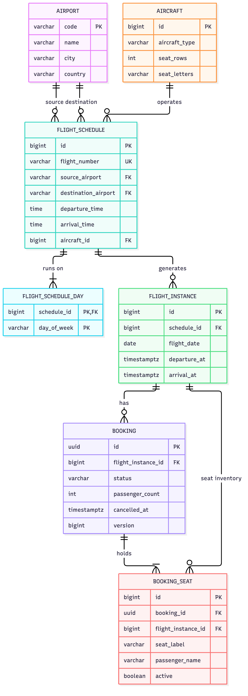

# Airline Ticketing System

Backend for a single-airline reservation system: flight schedule management (back office), flight search, live seat maps, booking and cancellation.

* Java 21, Spring Boot 4.1.1, PostgreSQL, Liquibase, MapStruct, Maven
* Two Maven modules: `airline-db` (Liquibase migrations) and `airline-core` (the service)

## Repository layout

```
├── README.md
├── hld/                    architecture.pdf, architecture.md, diagrams/ (Mermaid sources + PNGs)
├── lld/design.md           classes, APIs, validation, errors, transaction boundaries
├── airline-db/             Liquibase module
│   ├── schema.sql          reference DDL (generated from the migrations)
│   └── src/main/resources/db/{changelog-master.yaml, migrations/}
├── airline-core/           Spring Boot service
│   └── src/{main,test}/java/com/airlineticketing/...
└── docker-compose.yml        Postgres + app (runs from source, no Dockerfile)
```

## Run it

Prerequisite: **Docker** with Compose v2. Nothing else is needed - no local PostgreSQL, JDK or Maven.

### 1. Start everything

```bash
docker compose up -d
```

This starts:

* **PostgreSQL 16** - database `airline`, user `postgres`, password `postgres`, published on host port **5432**.
* **The service** - compiled and run inside a Maven/JDK 21 container from the project sources, on <http://localhost:8080>.

The first start downloads dependencies and compiles, so allow a minute or two (later starts are faster thanks to a cached Maven volume). Follow progress with:

```bash
docker compose logs -f app
```

The API is ready when <http://localhost:8080/actuator/health> returns `"status":"UP"`. On first start Liquibase creates the schema and seeds airports and aircraft automatically; there is no manual migration step.

### 2. Use it

See [Try the API](#try-the-api) below. To look at the data directly:

```bash
docker compose exec postgres psql -U postgres -d airline
```

or connect any SQL client to `localhost:5432`, database `airline`, user `postgres`, password `postgres`.

### 3. Stop

```bash
docker compose down        # keeps the database
docker compose down -v     # also deletes the database and Maven cache
```

If port 5432 or 8080 is already used on your machine, pick other host ports, e.g. `POSTGRES_HOST_PORT=5433 APP_PORT=9090 docker compose up -d` (the app always reaches the database internally at `postgres:5432`).

### Run tests

```bash
docker run --rm -v "$PWD":/workspace -w /workspace maven:3.9-eclipse-temurin-21 mvn -B test
```

This runs the 51 unit and controller tests. With a local JDK 21 you can use `./mvnw test` instead, and `./mvnw verify` additionally runs the integration/concurrency tests against PostgreSQL in Testcontainers (needs Docker; skipped automatically if Docker is not available).

### Optional: run the app from your IDE or JDK instead of in Docker

Start only the database, then run the app against it:

```bash
docker compose up -d postgres
DB_USERNAME=postgres DB_PASSWORD=postgres ./mvnw clean install
DB_USERNAME=postgres DB_PASSWORD=postgres ./mvnw -pl airline-core spring-boot:run
```

The app defaults to `jdbc:postgresql://localhost:5432/airline`; override with `DB_URL`, `DB_USERNAME`, `DB_PASSWORD`. Requires JDK 21.

## Database initialization

Liquibase runs automatically at startup (`airline-db/src/main/resources/db/changelog-master.yaml`). Migrations create the tables, constraints and indexes, and seed:

* Airports: `DXB, LHR, JFK, DEL, BOM, SIN, CDG, SYD`
* Aircraft: `1` = A320 (30 rows, A-F), `2` = B737-800 (32 rows, A-F), `3` = A220-300 (25 rows, A-D)

`airline-db/schema.sql` shows the resulting DDL for review. Hibernate runs with `ddl-auto=validate`, so the entities must match the migrated schema.

ER diagram:



## Try the API

```bash
# 1. Back office creates a schedule (instances for the next 365 days are generated)
curl -X POST localhost:8080/api/v1/admin/flight-schedules -H 'Content-Type: application/json' -d '{
  "flightNumber":"XY101","sourceAirportCode":"DXB","destinationAirportCode":"LHR",
  "departureTime":"09:30","arrivalTime":"13:45","aircraftId":1,
  "daysOfOperation":["MONDAY","WEDNESDAY","FRIDAY"]}'

# 2. Search (pick a date on one of those weekdays, within the next year)
curl 'localhost:8080/api/v1/flights/search?source=DXB&destination=LHR&date=2026-10-05'

# 3. View the seat map of a flight (flightId comes from the search result)
curl localhost:8080/api/v1/flights/1/seats

# 4. Book seats
curl -X POST localhost:8080/api/v1/bookings -H 'Content-Type: application/json' -d '{
  "flightId":1,"passengers":[{"name":"Alice","seatNumber":"1A"},{"name":"Bob","seatNumber":"1B"}]}'

# 5. Cancel (use bookingReference from step 4)
curl -X POST localhost:8080/api/v1/bookings/<bookingReference>/cancel
```

Endpoints (full details in [lld/design.md](lld/design.md)):

| Method and path | Purpose |
|---|---|
| `POST /api/v1/admin/flight-schedules` | Create schedule (admin) |
| `GET /api/v1/admin/flight-schedules[/{id}]` | List / read schedules (admin) |
| `GET /api/v1/flights/search` | Search by source, destination, date |
| `GET /api/v1/flights/{flightId}/seats` | Seat map |
| `POST /api/v1/bookings` | Create booking |
| `GET /api/v1/bookings/{bookingReference}` | Read booking |
| `POST /api/v1/bookings/{bookingReference}/cancel` | Cancel booking |

Health: `GET /actuator/health`. Every response carries an `X-Trace-Id` header that also appears in the logs.

## Design decisions

* **Separate modules.** `airline-db` owns the schema (Liquibase, append-only changesets with rollbacks); `airline-core` owns behaviour.
* **Layered packages.** controller (HTTP only) -> service (rules and transactions) -> repository (queries) -> entity; DTOs and mappers keep entities out of the API.
* **Flight instances: hybrid.** Schedules are templates. Instances are materialized for a rolling 365-day window: all at schedule creation, then a daily scheduled job (and a startup hook) fills in newly entering dates. Idempotent through `UNIQUE (schedule_id, flight_date)`; ShedLock prevents duplicate runs across replicas.
* **Sparse seat inventory.** Seat rows are not pre-created. Capacity is derived from the aircraft layout and only booked seats are stored, so storage grows with bookings, not with `days x seats`.
* **Invariants in the database.** A partial unique index on active seats makes double booking impossible even if application logic had a bug.
* **UTC throughout**; an arrival time at or before the departure time means arrival the next day.
* **Bounded APIs.** Search and list endpoints are paginated, capped at 100 per page.

Full reasoning, diagrams and assumptions: [hld/architecture.pdf](hld/architecture.pdf).

## Search algorithm

1. Validate the date is within `[today, today + 365 days]` (UTC) and the airport codes are IATA-shaped.
2. Flights are identified by querying `flight_instance` on `flight_date`, joined to its schedule for `source_airport` and `destination_airport` (index `idx_flight_instance_date`, `idx_flight_schedule_route`); flights that have already departed are excluded.
3. Schedules are matched at generation time, not at search time: only instances for operating weekdays exist, so a date that is not an operating day simply yields no rows.
4. Instances are generated when the schedule is created and by the daily window-extension job.
5. Availability = `seat_rows * seat letters - active booked seats`, with booked counts for the whole result page fetched in one grouped query.

## Booking algorithm

1. **Seat validation** - normalize labels (`1a` -> `1A`), reject empty/duplicate selections and more than 9 seats; after locking the flight, reject departed flights and seats that are not in the aircraft layout.
2. **Locking** - `SELECT ... FOR UPDATE` on the flight instance row serializes concurrent bookings of the same flight (different flights do not block each other).
3. **Transaction flow** - one transaction: lock flight, verify the seats are not active in `booking_seat`, insert `booking` and one `booking_seat` row per passenger, flush, commit.
4. **Booking creation** - status `CONFIRMED`, random UUID reference, response with flight number, date, passenger count and assigned seats.
5. **Concurrency handling** - the row lock gives a clean `409 SEAT_ALREADY_BOOKED` for losers; the partial unique index `(flight_instance_id, seat_label) WHERE active` is the final guard. Verified by integration tests with 20 racing threads.

## Cancellation algorithm

1. **Booking lookup** - `SELECT ... FOR UPDATE` on the booking by reference (404 if unknown).
2. **Status check** - already cancelled bookings return `409 BOOKING_ALREADY_CANCELLED`.
3. **Transaction flow** - in one transaction set status `CANCELLED` and `cancelled_at`, and mark the booking's seats `active = false`.
4. **Seat release** - inactive rows no longer count as booked and are ignored by the unique index, so the seats are immediately bookable again; the history stays for audit. Refunds are out of scope.

## Assumptions

* Single airline; one seat belongs to one booking; one booking covers one flight instance.
* Seat maps are fixed per aircraft; schedules are immutable after creation (no update/delete API).
* Airports and aircraft are preloaded by migration; no CRUD for them.
* Bookable window is today (UTC) to today + 365 days; departed flights cannot be searched or booked.
* All timestamps are UTC; no time-zone conversion.
* Passenger information is a name only, with no validation; max 9 seats per booking (`airline.max-seats-per-booking`).
* No authentication. Admin endpoints are under `/api/v1/admin/**` so they can be protected at a gateway.
* One schedule per flight number; aircraft availability across schedules is not checked.

## Configuration

| Property / env var | Default |
|---|---|
| `DB_URL` | `jdbc:postgresql://localhost:5432/airline` |
| `DB_USERNAME` / `DB_PASSWORD` | empty (set to `postgres` / `postgres` when using the compose database outside Docker) |
| `airline.booking-window-days` | `365` |
| `airline.max-seats-per-booking` | `9` |
| `airline.flight-generation.cron` | `0 5 0 * * *` (UTC) |
