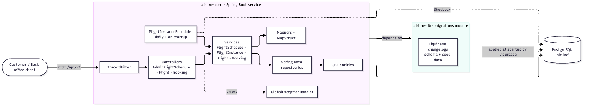
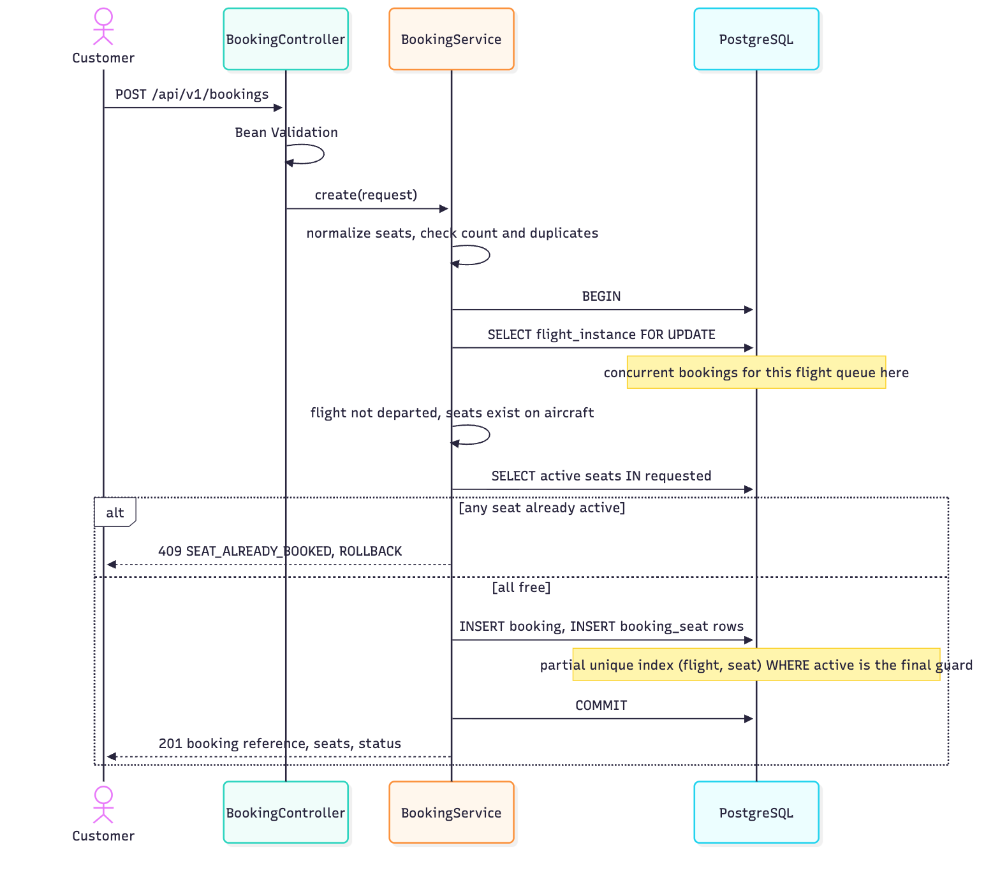
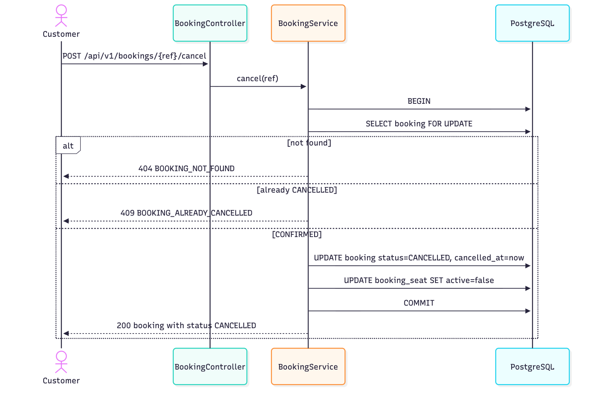
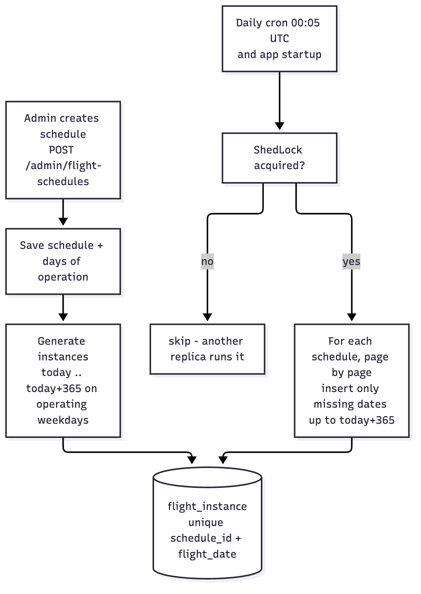

# Airline Ticketing System - High-Level Design

## 1. Overall architecture

A single Spring Boot service (`airline-core`) exposes a REST API for the back office (flight schedule management) and customers (search, seat map, booking, cancellation). All state lives in PostgreSQL. The schema is owned by a separate Maven module (`airline-db`) that ships Liquibase changelogs; the service applies them at startup and Hibernate validates the entity mapping against the result (`ddl-auto=validate`).

## 2. Components

| Component | Responsibility |
|---|---|
| `airline-db` module | Liquibase changelogs: tables, constraints, indexes, ShedLock table, seed airports and aircraft. No Java code. |
| `airline-core` module | Controllers, services, mappers, repositories, entities, scheduler, error handling. Depends on `airline-db`. |
| Controllers | HTTP binding and Bean Validation only. Admin schedule API, flight search and seat map API, booking API. |
| Services | All business rules and transaction boundaries. |
| Mappers (MapStruct) | Entity to DTO and request to entity conversion. |
| Repositories (Spring Data JPA) | Queries and pessimistic-lock queries. |
| `FlightInstanceScheduler` | Keeps the bookable window rolling forward; guarded by ShedLock so multiple replicas never run it twice. |
| `GlobalExceptionHandler` | Maps every failure to one error contract with a stable `errorCode` and a `traceId`. |
| `TraceIdFilter` | Puts a `traceId` in the logging MDC and echoes it as `X-Trace-Id`. |
| PostgreSQL | Single source of truth, including the concurrency guarantees. |

## 3. Service interactions and request flow

Every request passes `TraceIdFilter`, then a controller (validation), then a service (`@Transactional`), then repositories and PostgreSQL. Services never return entities; mappers produce DTOs inside the transaction (open-in-view is disabled).

* **Create schedule** - validate airports/aircraft, insert the schedule and its operating days, materialize flight instances for the next 365 days, all in one transaction.
* **Search** - indexed query on `flight_instance` joined to the schedule for source, destination and date; seat counts for the returned page are fetched with one grouped query.
* **Seat map** - the aircraft's fixed layout minus the currently active `booking_seat` rows, read at request time, so it is always the live state.
* **Book / cancel** - see section 6 and the sequence diagrams.

## 4. Flight generation strategy (hybrid)

Schedules are templates; bookings need real rows to lock and reference, so instances are materialized, but only inside a rolling window.

* On schedule creation: one `flight_instance` row per operating date from today to today + 365 days.
* A daily job (00:05 UTC) and an application-start hook add the dates that entered the window. Both are idempotent: existing dates are skipped and `UNIQUE (schedule_id, flight_date)` is the backstop.
* Seats are **not** materialized. Capacity comes from the aircraft (`seat_rows` x `seat_letters`); only booked seats are stored. Inventory therefore costs rows proportional to bookings, not to 365 days x 180 seats per schedule.
* Rejected alternatives: purely dynamic generation cannot carry per-flight state or locks; purely materialized generation stops working after a year without a refresh job.

## 5. Major design decisions

1. **Two Maven modules** - the schema lifecycle (Liquibase) is separated from the runtime service; the core never creates or alters tables itself.
2. **Sparse seat inventory** - availability = capacity - active booking seats. Cancelled seats keep their history with `active = false`.
3. **Database enforced invariants** - a partial unique index `(flight_instance_id, seat_label) WHERE active` makes double booking impossible regardless of application bugs.
4. **UTC everywhere** - `timestamptz` for instants, `time` (UTC) for template times; JDBC time zone is pinned to UTC. An arrival time not after the departure time means the arrival is on the next day.
5. **UUID booking reference** - unguessable, collision-free, no allocation round trip.
6. **Single error contract and trace ids** - clients branch on `errorCode`; support can find the log lines via `traceId`.
7. **Bounded paging** - list and search endpoints are paginated (page and size) with a hard cap of 100 rows per page.

## 6. Concurrency strategy

| Concern | Mechanism |
|---|---|
| Two customers booking the same seat | `SELECT ... FOR UPDATE` on the `flight_instance` row serializes bookings per flight; the availability check then runs against a stable view. |
| Anything slipping past the check | Partial unique index on active seats; a violation is translated to `409 SEAT_ALREADY_BOOKED`. |
| Partial bookings | One transaction: booking and all its seats commit or roll back together. |
| Double cancellation | `SELECT ... FOR UPDATE` on the booking row plus a `@Version` column; second cancel returns `409 BOOKING_ALREADY_CANCELLED`. |
| Deadlocks | Booking only locks the flight row; cancellation only locks the booking row; neither takes the other's lock. |
| Cancel racing a new booking | The seat becomes free when the cancelling transaction commits; the unique index ignores inactive rows. |
| Scheduler on multiple replicas | ShedLock row lock in `shedlock`. |

Trade-off: serializing per flight limits throughput on a single flight to the speed of a short transaction. That is acceptable for this domain and far simpler than per-seat locking.

## 7. Assumptions

* Single airline; one seat belongs to one booking; one booking covers one flight instance.
* Seat maps are fixed per aircraft; schedules never change after creation (so there is no update or delete schedule API).
* Airports and aircraft are preloaded (seeded by migration); no CRUD for them.
* Bookable window is today (UTC) to today + 365 days; flights that have already departed cannot be searched or booked.
* All times are UTC; no time-zone conversion.
* Passenger data is a name only, without validation. A booking holds at most 9 seats (configurable).
* No authentication; admin endpoints live under `/api/v1/admin/**` so a gateway can protect them later.
* A flight number maps to exactly one schedule. Aircraft double-booking across schedules is not checked.
* Refunds and payments are out of scope.
